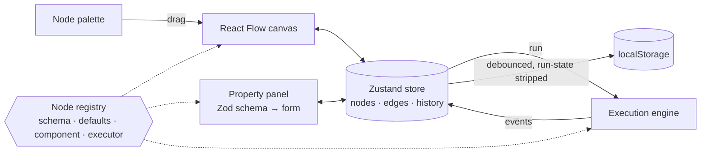

# Patchbay

A node-based AI workflow builder. Wire triggers, prompts, conditions and outputs together on a canvas, then **run** the graph and watch data flow between nodes.

Everything runs in the browser. The AI step is **simulated** (it streams a canned response), so there is no backend and no API key. Workflows persist in `localStorage`.

**Stack:** Next.js (App Router) · React Flow (`@xyflow/react`) · Zustand · Zod + React Hook Form · Tailwind + shadcn/ui · Vitest + Testing Library · Playwright

## Features

- **Canvas:** drag nodes from the palette, connect handles, pan/zoom, minimap, delete with Backspace.
- **Five node types:** Trigger, AI Prompt, Condition (true/false routing), Transform, Output.
- **Schema-driven property panel:** the settings form for each node is generated from that node's Zod schema.
- **Undo / redo:** capped history with coalescing (a burst of typing, or deleting a node plus its edges, is one step). `⌘/Ctrl+Z`, `⇧⌘/Ctrl+Z`.
- **Run mode:** independent branches run in parallel, joins wait for all live inputs, Condition nodes follow one branch and skip the other. Active edges animate; AI nodes show a skeleton, then streamed text. Cancellable.
- **Dashboard + autosave:** create, duplicate, delete, import/export JSON. Imports are validated end to end.
- **Command palette:** `⌘/Ctrl+K`.
- **Dark mode:** follows the OS setting.

## Architecture



```
src/
├── app/
│   ├── dashboard/          saved workflows list
│   └── editor/[id]/        canvas workspace
├── components/
│   ├── canvas/             React Flow wrapper, editor shell, command palette, autosave
│   ├── nodes/              node components, Zod schemas, executors, registry.ts
│   ├── sidebar/            node palette, schema-driven property editor
│   ├── dashboard/
│   └── ui/                 shadcn primitives
├── store/useWorkflowStore.ts   graph, selection helpers, history, run state
├── types/                  workflow + execution types
└── utils/
    ├── executionEngine.ts  simulated runner
    ├── exportImport.ts     versioned JSON format + validation
    └── persistence.ts      localStorage repository
```

## Design decisions

**Per-node subscriptions.** Updating a node replaces only that node's object (`updateNodeData`), and consumers subscribe by id (`selectNodeById`). A Profiler-based test types five characters into one node and asserts that a sibling node's subscriber never re-rendered. Node components are also wrapped in `memo`. Note this is verified by render counts in a test, not by a frame-rate benchmark.

**Registry pattern.** `nodeRegistry` is the single table the canvas, palette, property panel and engine all read from. Each kind declares `schema`, `defaults`, `component` and `execute`. The engine takes an executor lookup and has no knowledge of node kinds, and a test runs it with a custom executor to prove it.

**History as snapshots with coalescing.** Snapshots of `{nodes, edges}` are pushed before add, connect, delete, drag start and edits, capped at 20. Immutable updates mean unchanged nodes are shared between snapshots, so this is cheap. A keyed time window collapses typing bursts and React Flow's back-to-back node-then-edge delete events into single steps. Run state (status, output, edge animation) is deliberately **not** recorded.

**Run state is not document state.** `patchRuntime` updates statuses without touching history, and serialization strips them, so running a workflow never dirties the undo stack or triggers a save. Autosave compares the serialized, run-free form with the last save rather than trusting change events.

**Engine semantics.** Nodes are scheduled as their incoming edges resolve (delivered or skipped), not by fixed waves. A node whose inputs were all skipped is skipped, and so is everything depending only on it. Cycles and missing triggers are rejected before anything runs. Cancellation is an `AbortSignal` honored in every simulated delay.

**Validation at the boundary.** Persisted data and imported files go through the same Zod pipeline: file shape and version, unique ids, edge endpoints, and each node's settings against its own schema. Corrupt storage or an invalid entry is dropped rather than crashing.

**Known limits / honest notes**
- The AI node is a simulation, and Condition nodes do not evaluate expressions (they route on keywords such as `false`/`fail`/`error`). Putting `[fail]` in a prompt forces a failure so the error path is demonstrable.
- Storage is `localStorage`, so workflows are per-browser and there is no sync or collaboration.
- Undo snapshots include the current selection and any run state present at that moment.

## Add a new node type

1. Define a Zod schema in `src/components/nodes/schemas.ts`. Use `.meta({ title, widget })` for UI hints; the property panel is generated from it.
2. Add the node component (see `TransformNode.tsx`) and an executor in `executors.ts`.
3. Register it in `src/components/nodes/registry.ts` and add the kind to `NodeKind` in `src/types/workflow.ts`.

The palette, canvas, property panel, import validation and engine pick it up automatically. The registry tests fail if the defaults don't satisfy the schema.

## Getting started

```bash
npm install
npm run dev
```

| Command | What it does |
| --- | --- |
| `npm run dev` | Dev server |
| `npm run build` / `npm start` | Production build / serve |
| `npm run lint` | ESLint |
| `npm run typecheck` | TypeScript |
| `npm test` | Unit and component tests (Vitest) |
| `npm run e2e` | End-to-end tests (Playwright, runs against a production build) |

First-time e2e setup: `npx playwright install chromium`. To reuse an installed Chrome instead, run `PW_CHANNEL=chrome npm run e2e`.

CI (`.github/workflows/ci.yml`) runs lint, typecheck, unit tests and build, then the e2e suite.

## Deploying

The app is static plus client-side code with no server dependencies, so it deploys to Vercel as-is: import the repo and accept the defaults.

## Roadmap

- [x] M0: Scaffold, folder structure, core types
- [x] M1: Canvas and node registry
- [x] M2: Zustand store with per-node selectors
- [x] M3: Schema-driven property editor
- [x] M4: Undo/redo history
- [x] M5: Simulated execution engine
- [x] M6: Persistence, dashboard, import/export
- [x] M7: Polish, CI, command palette, dark mode
- [ ] Optional: real model calls via a Next.js server action (API key kept server-side)
